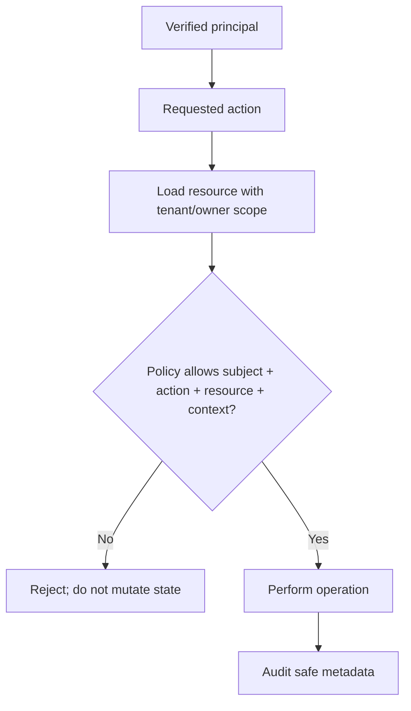

# Authentication Flow Diagrams

These Mermaid diagrams are learning aids. Confirm protocol-specific details against standards and maintained library documentation.

## Password login with server-side session

```mermaid
sequenceDiagram
  participant B as Browser
  participant A as Application
  participant DB as Account DB
  participant S as Session Store
  B->>A: Submit credentials over HTTPS
  A->>A: Validate request shape
  A->>DB: Find account by canonical identifier
  DB-->>A: Account + password hash
  A->>A: Verify using password-hashing library
  A->>S: Create new unpredictable session
  S-->>A: Session persisted
  A-->>B: Set-Cookie Secure; HttpOnly; SameSite policy
  B->>A: Protected request with cookie
  A->>S: Resolve and validate session
  S-->>A: Active session and principal reference
  A-->>B: Protected response after authorization
```

## Refresh-token rotation

```mermaid
sequenceDiagram
  participant C as Client
  participant A as API
  participant DB as Token Store
  C->>A: Present refresh token R1
  A->>DB: Atomically consume R1 and create R2
  alt R1 active
    DB-->>A: R2 created; R1 consumed
    A-->>C: New access token + R2
  else R1 already consumed
    DB-->>A: Reuse detected
    A->>DB: Apply documented family revocation policy
    A-->>C: Reject and require reauthentication
  end
```

## Authorization decision



## OIDC Authorization Code + PKCE (conceptual)

```mermaid
sequenceDiagram
  participant C as Client
  participant B as Browser
  participant AS as Authorization Server
  participant RP as Callback
  C->>C: Create state, nonce, PKCE verifier/challenge
  C->>B: Redirect with challenge, state, nonce, redirect_uri
  B->>AS: Authorization request
  AS->>AS: Authenticate user; obtain consent as required
  AS-->>B: Redirect with authorization code and state
  B->>RP: Callback with code and state
  RP->>RP: Validate state
  RP->>AS: Exchange code + PKCE verifier
  AS-->>RP: Tokens
  RP->>RP: Validate ID token signature, issuer, audience, expiry, nonce
```
