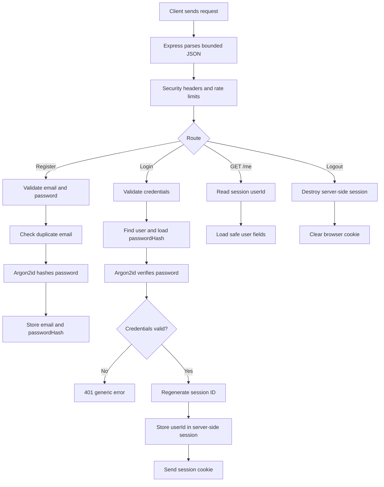

# 33 — Build Authentication Step by Step: A Code-First Walkthrough

This chapter is the practical spine of AuthMaster. Follow it in order. Do not paste the entire lab and skip to the end: after every step, explain what the code does, run the check, and deliberately test a failure case.

> **Safety boundary:** This is a local learning lab, not a production-ready identity service. Use synthetic accounts and a development database only. Read [the lab security notes](../labs/session-auth-api/SECURITY-NOTES.md). Do not expose this API to the public internet.

## What you will build

An Express API backed by MongoDB that can:

1. Register an account and store an Argon2id password hash.
2. Verify credentials during login.
3. Create a server-side session and send the browser a session cookie.
4. Return the current user's safe profile.
5. Destroy the session during logout.
6. Reject invalid input and return predictable error responses.
7. Run automated checks without needing a real user account.

### The end-to-end request flow



The browser cookie normally contains a session identifier, not the user's password or complete profile. The server uses that identifier to look up session state. Cookie delivery is not permission to access every resource: each protected resource still needs an authorization decision.

## Step 0 — Prepare the environment

Requirements:

- Node.js 20 or newer
- MongoDB running locally or a development database URI
- A terminal and an HTTP client such as curl, Postman, or Bruno

Open a terminal in `labs/session-auth-api`.

Install dependencies:

```bash
npm install
```

Create your local environment file:

**macOS/Linux**
```bash
cp .env.example .env
```

**PowerShell**
```powershell
Copy-Item .env.example .env
```

Generate a random session secret:

```bash
node -e "console.log(require('crypto').randomBytes(48).toString('hex'))"
```

Paste the output into `.env` as `SESSION_SECRET`. Set `MONGODB_URI` to your development database. Never commit `.env`; do not paste the secret into chat or screenshots.

Example shape only — replace the secret with your own generated value:

```dotenv
NODE_ENV=development
PORT=3000
MONGODB_URI=mongodb://127.0.0.1:27017/authmaster
SESSION_SECRET=replace-this-with-your-own-random-output
```

The example secret above is intentionally invalid; the application should refuse to start with a placeholder. Generate a real value locally.

Start MongoDB, then run:

```bash
npm run dev
```

Check the health endpoint in a second terminal:

```bash
curl -i http://localhost:3000/health
```

Expected: HTTP 200 and a small JSON body such as `{"status":"ok"}`. A health response proves the process is responding; it does not prove database-backed registration works.

### If startup fails

- **Invalid SESSION_SECRET:** replace the placeholder with at least 32 bytes of random data.
- **MongoDB connection error:** check that the database is running and the URI points to the correct database.
- **Port in use:** change `PORT` in `.env` to an available port and use that port in later commands.

## Step 1 — Understand the folder structure

```text
labs/session-auth-api/
├── src/
│   ├── app.js           # Express middleware, routes, errors
│   ├── auth.routes.js   # Registration, login, /me, logout
│   ├── config.js        # Validates environment variables
│   ├── db.js            # Connects Mongoose to MongoDB
│   ├── server.js        # Starts DB connection and HTTP listener
│   ├── validation.js    # Validates request credentials
│   └── models/
│       └── User.js      # User persistence schema
├── test/                # Automated tests
├── .env.example
├── package.json
└── SECURITY-NOTES.md
```

Keep these responsibilities separate:

- `server.js` starts infrastructure.
- `app.js` composes middleware and routes.
- `auth.routes.js` handles HTTP use cases.
- `validation.js` checks untrusted input.
- `User.js` defines persisted user data.
- `config.js` validates startup configuration.

A useful request path is:

`HTTP request → middleware → route → validation → database/crypto → response`

## Step 2 — Validate input before using it

Open `src/validation.js`:

```js
const { z } = require('zod');

const credentialsSchema = z.object({
  email: z.string().trim().email().max(254)
    .transform(value => value.toLowerCase()),
  password: z.string().min(12).max(128),
}).strict();

function parseCredentials(input) {
  return credentialsSchema.safeParse(input);
}

module.exports = { credentialsSchema, parseCredentials };
```

### Understand every important decision

- `z.object(...)` defines the accepted request shape.
- `trim()` removes accidental spaces around an email address.
- `email()` rejects values that do not match the validator's email format.
- `max(254)` bounds the email field.
- `toLowerCase()` normalizes email lookup in this lab. Production identity policies should explicitly decide how identifiers are normalized.
- `min(12)` and `max(128)` set the lab's password input bounds. Password policy should be aligned with current guidance and the application's threat model.
- `.strict()` rejects unexpected fields such as a client-supplied `role: "admin"`.
- `safeParse()` returns a result instead of throwing for ordinary validation failures.

**Important:** validation is not authentication. It only checks the shape of the input. A valid-looking email and password still have to be checked against the stored account.

### Practice

Try a valid email with a password shorter than 12 characters. Then add a `role` property to an otherwise valid body. Both should fail validation. Never accept a role or trusted user ID from the registration body as authority.

## Step 3 — Understand the user data model

Open `src/models/User.js`:

```js
const mongoose = require('mongoose');

const userSchema = new mongoose.Schema({
  email: {
    type: String,
    required: true,
    unique: true,
    lowercase: true,
    trim: true
  },
  passwordHash: {
    type: String,
    required: true,
    select: false
  },
}, { timestamps: true });

module.exports = mongoose.model('User', userSchema);
```

The database stores a password hash, never the original password. `select: false` helps prevent the hash from appearing in ordinary Mongoose queries; the login route explicitly opts in with `.select('+passwordHash')` because it must verify the supplied password.

The `unique: true` declaration creates/requests a unique index; it is not a friendly validation message by itself. Two concurrent registration requests can race. The route handles MongoDB duplicate-key error code `11000` as a final safeguard.

A user response should be an allow-listed object such as `{ id, email }`, not the entire database document. Do not return `passwordHash`, session data, reset tokens, or internal fields.

## Step 4 — Trace registration

The registration route follows this sequence:

1. Parse and validate the body.
2. Normalize the email.
3. Check whether the account already exists.
4. Hash the password with Argon2id.
5. Store the email and hash.
6. Return a safe profile with HTTP 201.

The key implementation in `src/auth.routes.js` is:

```js
const parsed = parseCredentials(req.body);
if (!parsed.success) {
  return res.status(400).json({
    error: 'Invalid email or password format'
  });
}

const { email, password } = parsed.data;
const existing = await User.exists({ email });

if (existing) {
  return res.status(409).json({
    error: 'Unable to register with those details'
  });
}

const passwordHash = await argon2.hash(password, {
  type: argon2.argon2id
});

const user = await User.create({ email, passwordHash });

return res.status(201).json({
  user: { id: user.id, email: user.email }
});
```

### Why hash passwords?

A password is a secret with high reuse risk. If a database is exposed, plaintext passwords immediately disclose the credentials themselves. A password-specific hash such as Argon2id makes offline guessing more expensive. Hashing is not encryption: there is no decryption operation to recover the original password.

Argon2id still needs sensible parameters, capacity planning, and abuse controls. Expensive hashing can be used to exhaust server resources, so rate limiting and monitoring matter.

### Run registration

Use a synthetic account and keep the email/password only in your local test environment:

```bash
curl -i -X POST http://localhost:3000/auth/register \
  -H "Content-Type: application/json" \
  -d '{"email":"learner@example.com","password":"Demo-Password-123!"}'
```

Expected first response: HTTP 201 with a safe user object. Repeating the same email should return HTTP 409 in this lab. A production system may choose a less revealing account-enumeration policy; the response strategy should be deliberate.

### Check the database

Inspect the development database and verify the document has `email` and `passwordHash`, but not a plaintext `password` field. Never share a database dump containing real user information.

## Step 5 — Trace login and session rotation

Login performs these checks:

1. Validate the request body.
2. Find the account by normalized email.
3. Explicitly load the password hash.
4. Verify the password with Argon2id.
5. Return the same generic credential error for unknown account and wrong password.
6. Regenerate the session identifier.
7. Store the authenticated user ID in server-side session state.
8. Save the session before returning success.

The core code:

```js
const user = await User.findOne({ email }).select('+passwordHash');

if (!user || !(await argon2.verify(user.passwordHash, password))) {
  return res.status(401).json({ error: 'Invalid email or password' });
}

req.session.regenerate(error => {
  if (error) return next(error);

  req.session.userId = user.id;

  req.session.save(saveError => {
    if (saveError) return next(saveError);

    return res.json({
      user: { id: user.id, email: user.email }
    });
  });
});
```

### Why regenerate the session?

Imagine an attacker can cause a victim to use a session identifier the attacker already knows. If login upgrades that same identifier to an authenticated session, the attacker may be able to reuse it. Regenerating the ID at the authentication boundary reduces this session-fixation risk.

The session ID is a bearer credential: whoever possesses a valid one may be treated as that session. Do not print it in logs or share it in screenshots.

### Why save before responding?

The callback-based flow waits for the session store's save operation before sending success. This helps avoid a client receiving a successful login response before the session is persisted. The exact behavior should be tested with the chosen session store.

### Run login and save the cookie

```bash
curl -i -c cookies.txt -X POST http://localhost:3000/auth/login \
  -H "Content-Type: application/json" \
  -d '{"email":"learner@example.com","password":"Demo-Password-123!"}'
```

The `-c cookies.txt` option stores cookies for subsequent local requests. Treat `cookies.txt` like a password; it contains a session credential. Do not commit it.

Expected: HTTP 200, a safe user object, and a `Set-Cookie` header. A wrong password should return HTTP 401 with a generic error.

## Step 6 — Understand the session cookie

The app configures `express-session` with these key settings:

```js
app.use(session({
  name: 'authmaster.sid',
  secret: sessionSecret,
  resave: false,
  saveUninitialized: false,
  cookie: {
    httpOnly: true,
    secure: nodeEnv === 'production',
    sameSite: 'lax',
    maxAge: 60 * 60 * 1000,
  },
}));
```

- **HttpOnly:** client-side JavaScript cannot read the cookie through ordinary browser cookie APIs. It does not eliminate XSS or prevent injected scripts from making requests.
- **Secure:** browsers send the cookie only over HTTPS when enabled. Production needs HTTPS and correct reverse-proxy configuration.
- **SameSite=Lax:** limits some cross-site cookie sending. It is not a complete CSRF defense for every deployment.
- **maxAge:** sets a browser cookie lifetime. Server-side session expiry and invalidation policy must also be correct.
- **secret:** signs the session cookie value; it must be random, private, and rotated with a deliberate plan.

The default Express MemoryStore is for development, not production. Use a maintained persistent session store for real deployments. Do not “fix” a cookie issue by blindly disabling Secure or weakening SameSite.

## Step 7 — Protect a current-user route

The `GET /auth/me` route checks whether the session contains `userId`. If it does, the route loads only safe profile fields and returns them. If not, it returns HTTP 401.

```js
if (!req.session.userId) {
  return res.status(401).json({ error: 'Unauthenticated' });
}

const user = await User.findById(req.session.userId).select('email');
if (!user) {
  // The account no longer exists; invalidate the stale session.
  // See src/auth.routes.js for the full cleanup logic.
}
```

The identity used for this lookup comes from server-controlled session state, not a user ID in the request body. Later, when the app protects notes, invoices, or team data, it must additionally check ownership/permissions for each resource. Authentication answers “who is this session associated with?” Authorization answers “may this principal perform this action on this resource?”

Call the endpoint using the saved cookie:

```bash
curl -i -b cookies.txt http://localhost:3000/auth/me
```

Expected after successful login: HTTP 200 with the current user's safe profile. Without the cookie, expect HTTP 401.

## Step 8 — Trace logout

Logout must invalidate the server-side session and clear the browser cookie:

```js
req.session.destroy(error => {
  if (error) return next(error);

  res.clearCookie('authmaster.sid', {
    httpOnly: true,
    secure: nodeEnv === 'production',
    sameSite: 'lax',
  });

  return res.status(204).end();
});
```

Clearing the browser cookie alone is not enough if the server still accepts the old session identifier. Destroying the server-side session makes replay of that old ID fail when the store supports correct invalidation.

Run logout:

```bash
curl -i -b cookies.txt -X POST http://localhost:3000/auth/logout
curl -i -b cookies.txt http://localhost:3000/auth/me
```

Expected: logout returns HTTP 204; the next `/auth/me` request returns HTTP 401. Then deliberately try the old cookie from a controlled test client and verify it no longer authenticates.

## Step 9 — Read middleware in the correct order

Open `src/app.js`. Middleware order is behavior: a request passes through middleware in the order it is registered.

The lab:
1. disables the `X-Powered-By` header;
2. adds Helmet headers;
3. parses bounded JSON;
4. configures session handling;
5. sets `Cache-Control: no-store` for authentication routes;
6. applies baseline login and registration rate limits;
7. mounts the auth router;
8. exposes a minimal health endpoint;
9. maps known request parsing failures to safe error responses.

If the JSON parser throws for malformed input, the error handler returns HTTP 400. If the body exceeds the limit, it returns HTTP 413. Unexpected errors return a generic HTTP 500 response; logs should not contain passwords, cookies, tokens, or raw request bodies.

The included rate limits use an in-memory store. They do not coordinate across multiple instances and are not a complete abuse defense. Production requires shared rate-limit storage, correct proxy/IP configuration, monitoring, and threat-model-based tuning.

## Step 10 — Test the system

Run all included automated tests:

```bash
npm test
```

The current suite checks configuration validation, credential validation, basic HTTP headers, invalid input, malformed JSON, and oversized request bodies. It does not yet prove all valid registration/login/logout flows against a test database.

Use this manual matrix with a synthetic account:

| Scenario | Expected result | What it proves |
|---|---|---|
| Valid registration | 201 | Account can be created |
| Duplicate registration | 409 in this lab | Duplicate account is handled |
| Invalid email or short password | 400 | Input validation runs |
| Valid login | 200 + cookie | Credentials create a session |
| Wrong password | 401 | Invalid credentials are rejected |
| /auth/me without cookie | 401 | Anonymous request is not authenticated |
| /auth/me with valid cookie | 200 | Session resolves to a user |
| Logout | 204 | Session is destroyed |
| /auth/me after logout | 401 | Old session is not accepted |
| Malformed JSON | 400 | Parser error is handled |
| Oversized JSON | 413 | Body limit is enforced |

For real automated integration tests, use a dedicated test database, deterministic cleanup, synthetic users, and assertions that denied requests do not mutate state. Browser-based tests are needed for cookie policies, SameSite, CSRF, redirects, and CORS behavior.

## Step 11 — Debug by following the request

When something fails, inspect the path in order instead of changing random settings:

1. Is the server running?
2. Did the request reach the expected route?
3. Was the body valid JSON with the correct content type?
4. Did Zod accept the request?
5. Did the database query find the expected user?
6. Did password verification succeed?
7. Did the session store save the session?
8. Did the response set a cookie?
9. Did the client store and resend that cookie?
10. Does the server-side session still exist and contain the expected user ID?

Never log the password, full cookie header, session ID, or token to debug the issue. Log a safe request ID and event category instead.

## Step 12 — Mastery exercises

Do these in order and write down the evidence for each:

### Beginner
- Explain the difference between registration and login.
- Explain why a password hash is stored rather than the password.
- Draw the request path from Express middleware to the route.
- Use curl to register, log in, call `/auth/me`, and log out.

### Intermediate
- Add a test for an unexpected `role` field.
- Add an integration test for invalid credentials.
- Prove session ID changes after login without printing or sharing the ID.
- Prove logout invalidates the server-side session.
- Verify every response returns only safe profile fields.

### Advanced
- Replace MemoryStore with a maintained persistent store in an isolated branch.
- Add a CSRF defense appropriate to the client topology and test it in a browser.
- Add account disablement and define how active sessions are revoked.
- Design password reset with single-use, expiring tokens and race-safe redemption.
- Add ownership-protected resources and tests for cross-user access.
- Write a threat model and document residual risks.

Do not implement MFA, OAuth, or JWT just to collect features. First make the current flow understandable and testable. Add each new mechanism only when you can explain its threat model, lifecycle, failure cases, and verification strategy.

## Final teach-back

Without reading this chapter, teach another person:

1. What the browser sends during login.
2. Where the password is checked.
3. Why the database stores a password hash.
4. What is inside the session cookie and what is stored server-side.
5. Why session rotation matters.
6. What `/auth/me` checks.
7. Why logout must invalidate server-side state.
8. Why authentication does not replace authorization.
9. Which controls this lab is still missing.
10. Which tests would be required before a real deployment.

If you can explain the flow, draw it, reproduce it locally, test its failure cases, and identify its remaining risks, you are ready to move to the JWT and OAuth/OIDC chapters.
