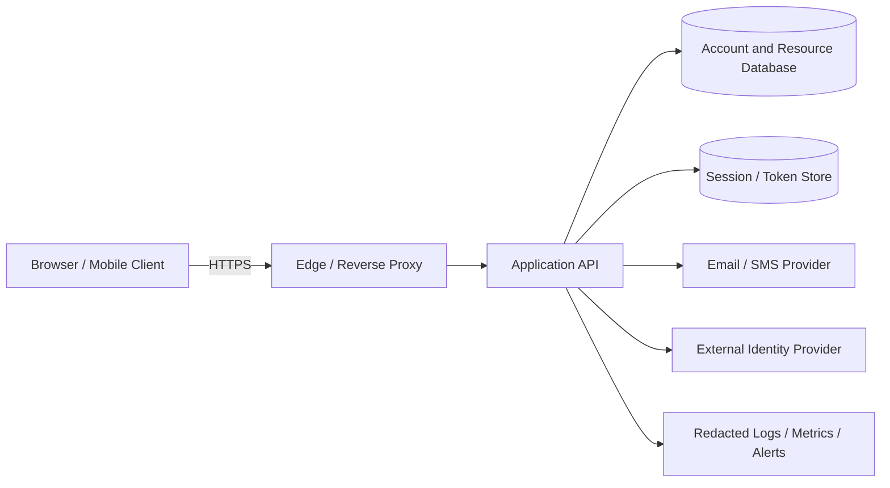
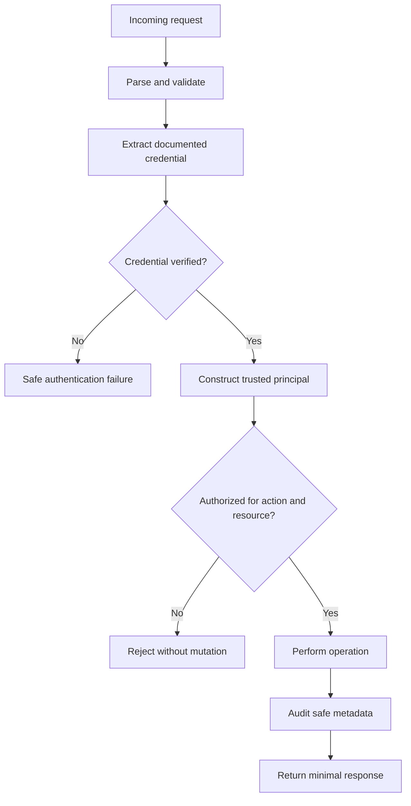

# End-to-End Authentication Reference Architecture

This is a teaching architecture, not a universal production prescription.

## Trust boundaries

The client is not the authority for identity, role, tenant, verification state, or resource ownership. TLS protects traffic to its termination point; deployment configuration determines which proxy-to-application hops are trusted.

## Request decision pipeline

## Separation of concerns

- **Credential parsing:** extract credential from a documented channel.
- **Verification:** validate signature, secret, expiry, revocation, or protocol state.
- **Principal construction:** map verified evidence to trusted identity context.
- **Authorization:** decide permission for the exact resource/action/context.
- **Persistence:** enforce uniqueness, transactions, atomic consumption, expiry, and tenant constraints.
- **Presentation:** return safe responses and deliberate cache/status behavior.
- **Operations:** manage secrets, rotation, telemetry, and incident response.

Do not merge all concerns into a single large login controller.

## Architecture decision record

For every application, document client type; session/token strategy; credential storage; lifetime and revocation; CSRF/CORS model; authorization model; recovery/MFA policy; key rotation; dependency outage behavior; logging and alerts; and test evidence.

## Review questions

- Can the client choose its own principal, role, tenant, or verified status?
- Can a stolen credential be revoked, and how quickly?
- Can a one-time token be consumed twice under concurrency?
- Are object queries scoped by ownership and tenant?
- Can any response, URL, referrer, analytics event, log, or error expose a secret?
- What happens if the database, session store, mail provider, or identity provider is unavailable?
- Which tests prove the above rather than merely asserting login returns 200?
